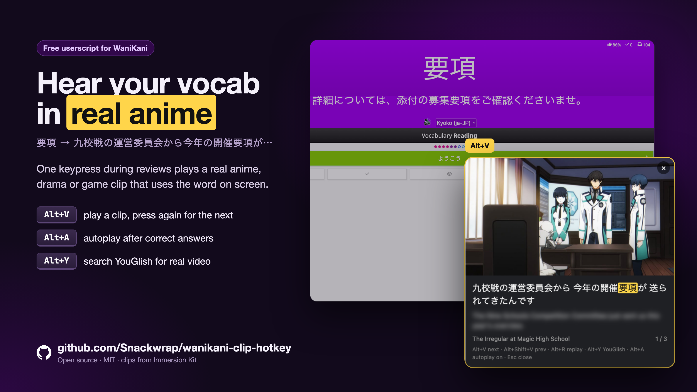

# WaniKani Clip Hotkey

A userscript for [WaniKani](https://www.wanikani.com). Press a hotkey during reviews or lessons to hear the current word or kanji used in a real anime, drama or game. Each clip is a screenshot plus the audio of the line, from [Immersion Kit](https://www.immersionkit.com).

## Install

1. Install a userscript manager: [Tampermonkey](https://www.tampermonkey.net/) or [Violentmonkey](https://violentmonkey.github.io/).
2. Open **[wanikani-clip-hotkey.user.js](https://raw.githubusercontent.com/Snackwrap/wanikani-clip-hotkey/main/wanikani-clip-hotkey.user.js)**. Your userscript manager will offer to install it.

The script needs no other scripts (it doesn't use WaniKani Open Framework). Updates come through your userscript manager.

## Hotkeys

Alt is Option on a Mac.

| Key | What it does |
|---|---|
| Alt+V | Open the clip panel and play a clip. Press again for the next one |
| Alt+Shift+V | Previous clip |
| Alt+R | Replay the current clip (clicking the screenshot also replays) |
| Alt+Y | Open a [YouGlish](https://youglish.com) search for the word in a new tab, for real YouTube video |
| Alt+A | Turn autoplay after a correct answer on or off |
| Esc | Close the panel |

The hotkeys work while your cursor is in the answer box, and they don't type anything into it.

## How it works

- Works in reviews, lessons and extra study, and uses whatever word or kanji is on screen.
- Clips that contain the exact word come first and shorter lines come before longer ones. Conjugated forms come after those.
- The English translation is blurred until you click it, so it won't give away the meaning before you answer.
- The panel closes when the next item comes up.
- Radicals have no clips.

## Autoplay after a correct answer

Press **Alt+A** to turn it on. When you answer correctly, a clip for that item plays automatically. A short message confirms the change, and the setting is remembered in that browser. Press Alt+A again to turn it off.

- It plays one clip per question, and nothing plays for wrong answers.
- Pressing Enter to move on stops the clip, so it never slows you down.
- If no clips exist for an item, nothing happens.
- To autoplay only after correct *readings*, set `AUTOPLAY_ON = 'reading'`.

## Settings

Edit the constants at the top of the script:

| Setting | Default | Meaning |
|---|---|---|
| `KEYS` | V / R / Y / A | Keys used together with Alt |
| `AUTOPLAY_DEFAULT` | `false` | Whether autoplay starts on, before you've ever pressed Alt+A |
| `AUTOPLAY_ON` | `'any'` | `'any'` correct answer, or `'reading'` only |
| `BLUR_TRANSLATION` | `true` | Blur the English until clicked |
| `MAX_CLIPS` | `40` | Clips kept per item |
| `VOLUME` | `0.9` | Playback volume |

## If clips stop loading

Clip data comes from Immersion Kit's API (`apiv2.immersionkit.com`) and its media host. If Immersion Kit moves its media again, update the `MEDIA` constant at the top of the script.

## Credits

Example sentences, screenshots and audio come from [Immersion Kit](https://www.immersionkit.com). This is an unofficial third-party script, not made by the WaniKani team.

## License

[MIT](LICENSE)
